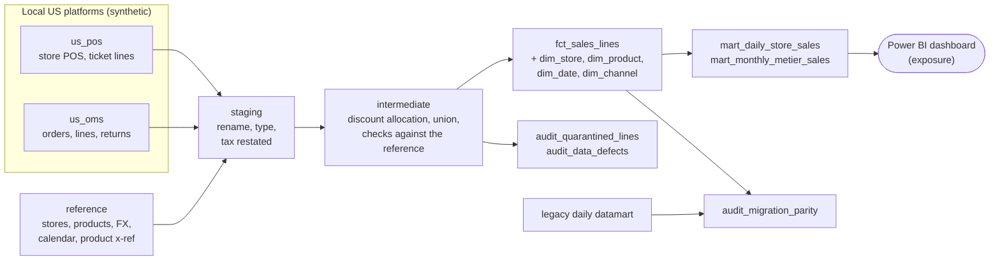

# retail-core-model-dbt

Two local US platforms describe the same sales in two different ways. This dbt project migrates them
to a group's core retail model: every gap of definition or grain between the sources and the target
is written down, handled by a rule and guarded by a test, and the result is reconciled with the
datamart the local teams read today.

[](https://github.com/Pchambet/retail-core-model-dbt/actions/workflows/ci.yml)


[](LICENSE)

All data is synthetic, written by a seeded generator for a fictitious house, « Maison Démo ».

**[Browse the models, the tests and the lineage](https://pchambet.github.io/retail-core-model-dbt/)** (the dbt documentation site, built from this repository).

## TL;DR

- **Two sources, one model.** A legacy store POS (ticket lines, tax included, local time, returns as
  negative lines, quantities by the box) and an e-commerce OMS (orders, lines and returns in three
  tables, tax excluded, UTC, an order-level discount on the header) land in one fact,
  `fct_sales_lines`, at one documented grain: one row per sale or return line.
- **24 record-level defects of 8 kinds are planted** in the source data, with their manifest. A data
  test requires the pipeline to flag **all 24 with the right code, and nothing else**.
- **Nothing is dropped silently.** A line is either in the fact or in a quarantine table with its
  reason: 3,509 lines exported, 3,489 loaded, 20 quarantined, and a test that fails if one is lost
  anywhere between the exports and the core model.
- **The migration reconciles with the legacy datamart to the cent**, per store and day, over 171
  store days: `legacy = core + duplicates dropped + lines quarantined`, unexplained difference 0.00.
- **94 data tests and 6 unit tests** on 26 models, contracts on the fact, the dimensions and the
  datamarts, an incremental fact, SQLFluff, and a CI that builds everything twice on every push
  (the second run takes the incremental path). Seven protections were broken on purpose; the
  build failed each time.
- **Runs on DuckDB** locally and in CI. A Snowflake target is written and parses, but **has not
  been run on Snowflake yet** (see [What was verified](#what-was-verified-and-what-was-not)).

## The problem

A group has a core retail model already live in other regions. The US region still reads its own
local platforms. Migrating is less about writing models than about finding where the same word does
not mean the same thing, or does not sit at the same grain, in the source and in the target, and
writing it down before the number reaches a datamart.



### What is real and what is simulated

| Part | Nature |
|---|---|
| The two platforms | **Simulated.** Their exports are CSV files written by [`generate.py`](src/retail_core_model_dbt/generate.py) (fixed seed, byte-for-byte reproducible, checked by a test) and loaded with `dbt seed`. There is no POS or OMS software behind them, and no ingestion tool: see [ADR 0002](docs/adr/0002-seeds-stand-in-for-ingestion.md). |
| The core retail model | **Invented for this sample**, in the usual shape of one: a sales fact at line grain and conformed dimensions. It is not any company's model. |
| The dbt project | **Real**: dbt Core 1.12 with the DuckDB adapter, built and tested in CI on every push. |
| Snowflake | **Not run yet.** The target and the adapter-specific macro are written; nobody has executed them on Snowflake. |
| The Power BI dashboard | **Fictitious.** It exists as a dbt exposure, to show the lineage down to its reader. |

## Gaps of definition and grain

Each row is a place where the two platforms and the core model disagree, the rule that settles it,
and the test that fails if the rule is removed. The column-by-column version is the
[source-to-target mapping](docs/source_to_target.md).

| Gap | Store POS | E-commerce OMS | Rule of the core model | Guarded by |
|---|---|---|---|---|
| Sales tax | Amounts include US sales tax | Amounts exclude tax | Net amounts exclude tax; the POS tax is kept in its own column | `assert_migration_parity_has_no_unexplained_difference` |
| Business day | Local time of the store | UTC | The store-local day; an order placed at 03:30 UTC belongs to the previous day in New York. 159 web sale lines change day | unit test `web_order_belongs_to_the_local_business_day` (both sides of the end of daylight saving time) |
| Returns | A negative line of a ticket | A separate table, on its own date | One row per return, negative quantity and amount, on the day it happened | `fct_sales_lines_sign_follows_line_kind` |
| Discount grain | On the line | On the order header (69 orders) | Spread over the lines pro rata, the rounding remainder on the largest line | unit test `order_discount_is_spread_to_the_cent`, `assert_order_discount_fully_allocated` |
| Unit of quantity | Sales units: a box of six plates is 1 | Mostly pieces | Pieces, through the cross-reference (`pieces_per_sales_unit`). 354 loaded lines change quantity | unit test `boxes_become_pieces_and_doubtful_codes_are_not_guessed` |
| Product code | Local POS code | Local web SKU | Group SKU through a cross-reference; a code mapped to two SKUs is not guessed, the same mapping written twice fails the build | same unit test, `relationships` to `dim_product`, planted-defects test, key of the cross-reference |
| Currency | USD | USD | USD kept, EUR added at the latest fixing on or before the business day (1,202 lines use an earlier fixing, weekends) | unit test `weekend_takes_fridays_fixing_and_no_rate_is_guessed`, `assert_datamarts_reconcile_with_fact` |
| Re-exports | The same line can arrive twice | n/a | The latest export wins; older copies are listed as defects | unit test `latest_export_of_a_pos_line_wins`, `unique` on `record_key`, parity test |
| Shipping fee | n/a | On the order header | Not merchandise: left out of net sales | header check in `int_oms__order_lines_allocated` |

## Results

### Every planted defect is found, and nothing else

| Defect | What it is | Planted | What the pipeline does |
|---|---|---|---|
| `DUPLICATE_LINE` | A POS line exported again in a later batch | 6 | Keeps the latest export, lists the copy |
| `UNMAPPED_PRODUCT` | A local product code absent from the cross-reference | 5 | Quarantines the line |
| `AMBIGUOUS_PRODUCT` | A local code mapped to two group SKUs | 3 | Quarantines the line, does not pick one |
| `UNKNOWN_STORE` | A store the group reference does not know yet | 3 | Quarantines the line |
| `SIGN_MISMATCH` | A negative quantity with a positive amount | 2 | Quarantines the line |
| `HEADER_LINES_MISMATCH` | An order whose header does not add up to its lines | 2 | Quarantines the whole order (4 lines) |
| `ORPHAN_RETURN` | A return pointing at an order line never exported | 2 | Quarantines the return |
| `MISSING_FX_RATE` | A sale older than the first exchange rate | 1 | Quarantines the line, no guessed rate |

`data_tests/assert_planted_defects_all_found_none_extra.sql` compares
[`audit_data_defects`](models/marts/audit/audit_data_defects.sql) with the generator's manifest,
record by record, in both directions.

The last kind was not in the first design. A test that counts every line in and out
(`assert_every_line_is_loaded_or_quarantined`) failed on the first build: two web order lines placed just
after midnight UTC belonged to the day before the first calendar day, and an inner join dropped them
without a word. The reference now starts earlier, and a line with no rate is quarantined by name.

### Migration parity with the legacy datamart

The legacy store datamart sums every exported POS row, tax included, re-exports and all.
[`audit_migration_parity`](models/marts/audit/audit_migration_parity.sql) restates the core model in
that definition and compares, per store and day:

| | USD |
|---|---|
| Legacy datamart | 2,698,208.42 |
| Core model, restated with tax | 2,689,910.97 |
| Explained: duplicates dropped | 38.60 |
| Explained: lines quarantined | 8,258.85 |
| **Unexplained** | **0.00** |

Reproduce with:

```bash
uv run dbt show --inline "select sum(legacy_sales_usd), sum(core_sales_usd), sum(explained_duplicates_usd), sum(explained_quarantine_usd), sum(unexplained_usd) from {{ ref('audit_migration_parity') }}"
```

### Seven protections broken on purpose

Each change was made alone, the warehouse was rebuilt in full, and the change was reverted.

| Change | What fails |
|---|---|
| De-duplication of re-exported lines removed | `unique` on `record_key` of the unioned lines (6 rows) |
| Sales tax left in the net amount | `assert_migration_parity_has_no_unexplained_difference` (all 171 store days) |
| Rounding remainder of the order discount dropped | unit test `order_discount_is_spread_to_the_cent` |
| UTC day used as the business day | unit test `web_order_belongs_to_the_local_business_day` |
| Unknown stores let through | `not_null` on the store and the channel of the fact, and `assert_planted_defects_all_found_none_extra` (3 rows each) |
| One row removed from the manifest of planted defects | `assert_planted_defects_all_found_none_extra` (a defect found that was not planted) |
| One row removed from the mapping | `assert_mapping_documents_every_fact_column` |

## How the project is built

- **Layers.** `staging` (11 views, one per source table: rename, nothing else, except on the POS
  lines the tax restatement, the business day and the rank of each re-export), `intermediate`
  (5 views: the business rules, one per model), `marts` (`core`: the fact and 4 dimensions;
  `sales`: 2 datamarts; `migration_audit`: 3 audit models).
  Schemas carry the same names on every target
  ([`generate_schema_name`](macros/generate_schema_name.sql)).
- **Sources** are declared with descriptions, and the two platforms with freshness on `loaded_at`.
  The sample data is static, so `dbt source freshness` warns by design; it is not a CI gate here.
- **Tests.** 88 generic data tests (keys, relationships, accepted values, ranges), 6 singular tests
  that state an invariant of the migration in plain SQL, and 6 unit tests on the rules that are
  easiest to get wrong. A key that carries an enforced `not_null` constraint has no `not_null`
  test on top: DuckDB and Snowflake both reject the null when the table is written.
- **Contracts** on the 7 models other teams read (fact, dimensions, datamarts): column names and
  types are part of the model, and a change that breaks them fails the build.
- **Incremental fact.** `fct_sales_lines` loads on `loaded_at` with `delete+insert` on
  `sales_line_id`, a hash of the source record: a line exported again replaces its earlier version
  instead of doubling, even when it turns a sale into a return. A nightly run also loads a line
  released from quarantine once its reference is fixed, and a post-hook removes a loaded line that a
  later export sends to quarantine ([ADR 0001](docs/adr/0001-grain-of-the-sales-fact.md)).
- **Macros**, three, each with a reason: [`utc_to_local`](macros/utc_to_local.sql) (the one
  expression DuckDB and Snowflake spell differently, dispatched per adapter),
  [`as_money`](macros/as_money.sql) (one money type, required by the contracts) and
  `generate_schema_name`.
- **Documentation.** Every model and every mart column is described; `dbt docs generate` builds the
  site with the lineage down to the Power BI exposure. CI uploads it as an artifact.
- **Mapping enforced.** The source-to-target mapping is a seed; a test compares it with the columns
  of the fact in the warehouse, and a Python test keeps its Markdown page in sync.
- **One build command, on purpose.** `dbt build --selector transform` runs everything after landing.
  The first version excluded the seeds instead, and dbt silently skipped the two tests that read a
  seed, the planted-defects test among them; counting the tests in `run_results.json` showed two
  fewer than declared ([`selectors.yml`](selectors.yml)).
- **CI.** [GitHub Actions](.github/workflows/ci.yml) runs ruff, pytest, SQLFluff, `dbt seed`,
  `dbt build` twice and `dbt docs generate` on every push. The same pipeline is written for
  [GitLab CI/CD](.gitlab-ci.yml) (stages lint, build, docs with Pages).

## Run it

Requires [uv](https://docs.astral.sh/uv/). On DuckDB, nothing else:

```bash
uv sync && uv run dbt deps
uv run dbt seed                                   # land the synthetic exports
uv run dbt build --selector transform             # 26 models, 94 data tests, 6 unit tests
```

Then `uv run dbt docs generate && uv run dbt docs serve` for the documentation and the lineage.
`uv run generate-data` rewrites the seeds (identical output), `uv run render-mapping` the mapping
page.

### On Snowflake (not run yet)

The `snowflake` target of [`profiles.yml`](profiles.yml) reads its settings from the environment
and holds no secret. With a trial account and key-pair authentication:

```sql
create database retail_core;
```

```bash
export SNOWFLAKE_ACCOUNT=<orgname-accountname>
export SNOWFLAKE_USER=<user>
export SNOWFLAKE_PRIVATE_KEY_PATH=<path to the private key registered on the user>
export SNOWFLAKE_PRIVATE_KEY_PASSPHRASE=<its passphrase, if the key is encrypted>
uv sync --group snowflake
uv run dbt seed --target snowflake
uv run dbt build --target snowflake --selector transform
```

Read against the dbt-snowflake 1.12.5 source and the Snowflake documentation, without an account:
seeds get unquoted, hence upper-case, column names, which the unquoted SQL of the models resolves;
a contract compares the type Snowflake gives a column with the type it gives
`cast(null as <declared type>)`, so `integer` and `decimal(18,2)` both read as NUMBER and `varchar`
as TEXT; the three-argument `convert_timezone` of `utc_to_local` takes and returns a
TIMESTAMP_NTZ, which `timestamp` is under the default `TIMESTAMP_TYPE_MAPPING`. Still open until
the first run: the time zone read from a column in `convert_timezone` (the reference shows
literals), and the order discount computed in exact decimals on Snowflake but in floating point on
DuckDB, which could move a cent between two lines of an order on an exact half-cent (none in this
data; the lines still add up to the header).

## What was verified and what was not

Verified, by a command whose result is in CI or was read on the machine:

- the whole build is green on DuckDB, on macOS and in the CI's Ubuntu; a second build is green and
  leaves the fact unchanged (3,489 rows, same total);
- the 24 planted defects are all found and nothing else is flagged;
- the legacy datamart and the core model reconcile to the cent;
- the seeds and the mapping page are exactly what their scripts write;
- the seven deliberate breaks above each fail the build;
- on a simulated second night (a line released from quarantine, a loaded line sent to quarantine by
  a re-export, a re-export that turns a sale into a return, two late lines), the incremental build
  is green and its fact equals the one of a full refresh (by hand, not in CI);
- the project parses with the Snowflake adapter (`dbt parse --target snowflake`);
- the script of the GitLab pipeline runs green in its container image
  (`ghcr.io/astral-sh/uv:python3.13-bookworm-slim`), on a laptop.

Not verified:

- **no model has run on Snowflake**;
- **the GitLab pipeline has not run on GitLab** (no runner, no Pages);
- nothing here was measured at volume: a few thousand lines, where a real platform has millions.

## Limits

- Seeds stand in for ingestion: there is no extract-and-load tool, no change data capture, no
  orchestration. `loaded_at` and the export batches imitate what one would leave behind.
- Two sources and one region. The core model is a plausible one, not a real group's.
- A loaded line is only rewritten when it is exported again: a change of logic upstream, or a
  reference correction that changes loaded values (a pack size, a rate), needs `--full-refresh`.
- Dimensions are loaded as they are: no history (slowly changing dimensions) is kept.
- An order with one bad line is quarantined as a whole or line by line depending on the defect;
  a real migration would agree these rules with the business teams first.

## About

A work sample built by Pierre Chambet with Claude Code, on synthetic data, to show how he would
approach the migration of local data platforms to a core model: sources mapped to one model, every
gap written down, tests before anything ships. It is not a product.

Decisions: [grain of the fact](docs/adr/0001-grain-of-the-sales-fact.md),
[seeds as ingestion](docs/adr/0002-seeds-stand-in-for-ingestion.md),
[tax and currency](docs/adr/0003-tax-and-currency-convention.md). Licence: [MIT](LICENSE).
